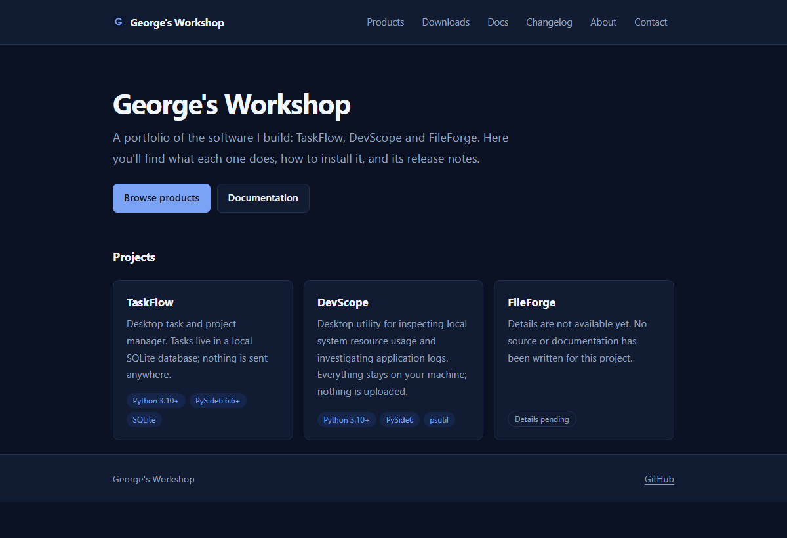
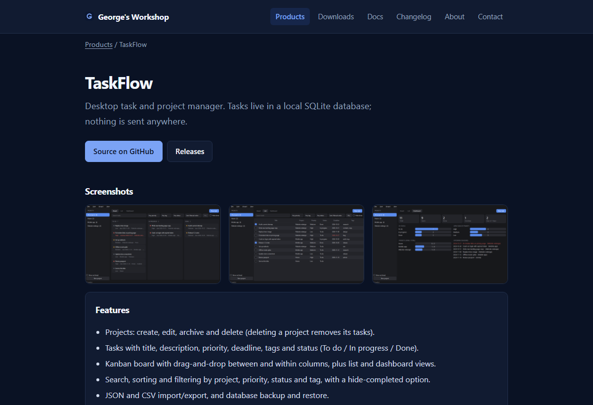
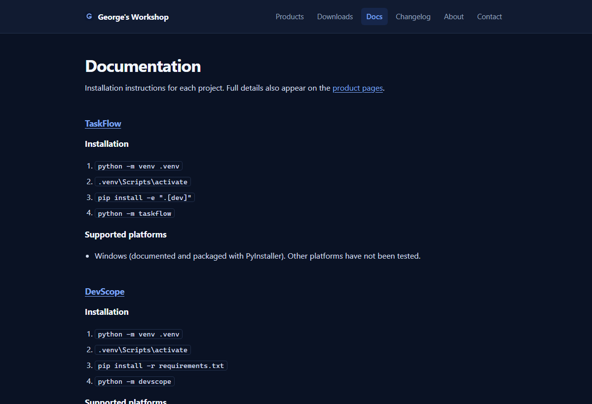

# George's Workshop

Portfolio and product catalogue for TaskFlow, DevScope and FileForge. Release data is read from the GitHub REST API (cached 10 minutes, with rate-limit and error handling).

**Stack:** React, TypeScript, Vite, React Router, Vitest + Testing Library.

## Screenshots

Home page:



Product page with screenshots, features and installation steps:



Documentation page:



## Run locally

```bash
npm install
npm run dev
```

## Build and test

```bash
npm test
npm run build      # output in dist/
npm run preview
```

## Configuration

Copy `.env.example` to `.env` to set an optional `VITE_GITHUB_TOKEN` (raises the API rate limit; use a no-scope token, since it ships in the client bundle). Product details live in `src/data/products.ts`; set a product's `repo` (`owner/name`) once its repository is public.

## Deployment

Pushes to `main` deploy to GitHub Pages via `.github/workflows/deploy.yml` (tests, then a build with base path `/georges-workshop/`). The workflow copies `index.html` to `404.html` so deep links work on Pages. For any other static host, run `npm run build`, serve `dist/`, and rewrite unknown paths to `index.html`.

## License

GPL-3.0-only. See [LICENSE](LICENSE).

## Acknowledgment

AI tools were used for development guidance.

